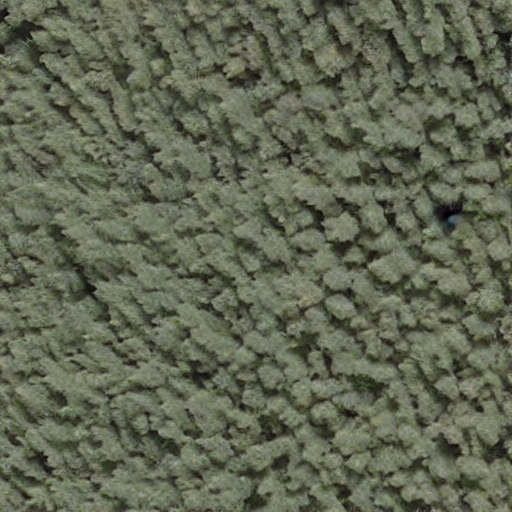
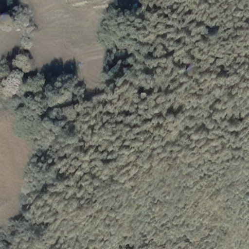
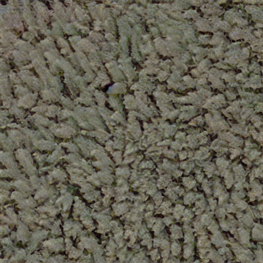
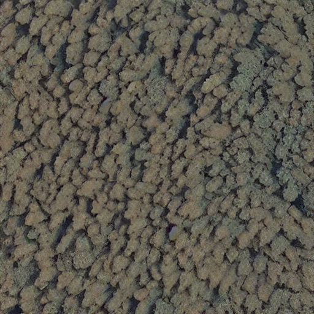
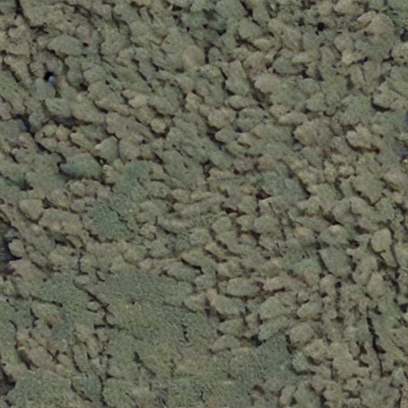
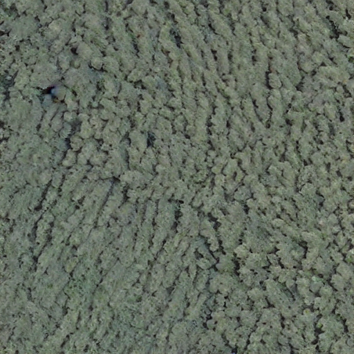

# Land-Cover Augmentation — LoRA-align

[日本語](README.md) · [简体中文](README.zh-CN.md) · **English**

An image generation and data augmentation project for aerial land-use classification. It includes classification workflows for bamboo, coniferous forest, rice fields and tea fields, with a focus on conditional bamboo image generation, filtering and training-set expansion.

**Python / PyTorch / CNN / Stable Diffusion / LoRA / scikit-learn**

## Features

- **Attribute tagging:** derive condition tokens from observation scale, color, illumination, shadow and sharpness.
- **LoRA domain adaptation:** adapt to bamboo aerial imagery and generate varied textures and appearances.
- **Conditional generation and filtering:** sample generation conditions from attribute distributions and select images that meet the configured criteria.
- **Classifier training:** add generated samples to the training set and classify land use with CNNs.

## Generated images

Bamboo aerial-style images generated with LoRA-align, showing different canopy textures, lighting and scene compositions.

<table>
  <tr>
    <td></td>
    <td></td>
    <td></td>
  </tr>
  <tr>
    <td></td>
    <td></td>
    <td></td>
  </tr>
</table>

## Code structure

| Directory | Contents |
| --- | --- |
| [`classifier/`](classifier/) | CNN classifiers, data loading and training |
| [`lora/`](lora/) | Attribute tagging, LoRA training wrapper and conditional generation |
| [`CNN_model/`](CNN_model/) | Image augmentation and generative-model experiments |
| [`evaluate.py`](evaluate.py) | Classification prediction processing |

## Run

Use Python 3.10–3.12. Prepare the source dataset, model weights and external training environment separately.

```bash
git clone https://github.com/zephyr-tmc/land-cover-augmentation.git
cd land-cover-augmentation
python3.12 -m venv .venv
source .venv/bin/activate
python -m pip install -r requirements.txt
python classifier/train.py --help
```

See [RUNNING.md](docs/RUNNING.md) for data formats and usage instructions.

## Acknowledgements

Data source: [Geospatial Information Authority of Japan dataset](https://gisstar.gsi.go.jp/gsi-dataset/index_ja.html). The LoRA training wrapper uses [kohya-ss/sd-scripts](https://github.com/kohya-ss/sd-scripts). Dependencies and foundation models retain their respective licenses.
