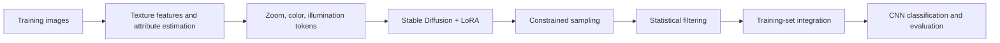
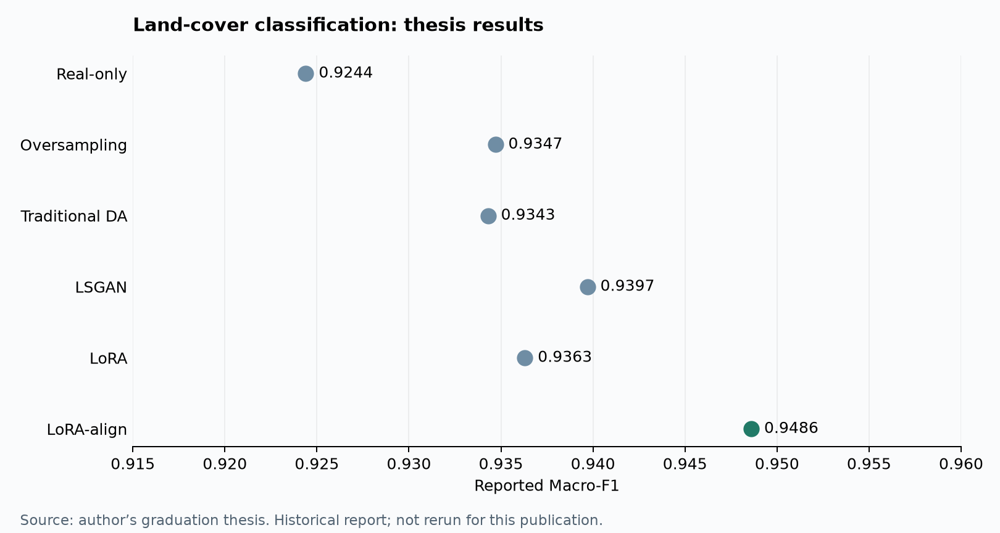

# Land-Cover Augmentation — LoRA-align

[日本語](README.md) · [简体中文](README.zh-CN.md) · **English**

Research code for generative data augmentation in aerial land-use classification. The task covers bamboo, coniferous forest, rice fields and tea fields, with a focus on generating samples consistent with real observation conditions.

**Python / PyTorch / CNN / GAN / Diffusion / LoRA / scikit-learn**

## Research question

Beyond increasing sample counts, how does matching the scale and appearance of generated imagery to real training data affect classification? This project focuses on mixed observation scales in the minority bamboo class.

## Method and implementation



- **Explicit conditions:** estimate observation scale from texture features and tokenize color, illumination, shadow and sharpness.
- **Domain adaptation:** use existing Stable Diffusion and LoRA training implementations for bamboo imagery.
- **Distribution-aware generation:** sample conditional attribute distributions, apply token dropout and vary generation settings.
- **Post-generation filtering:** retain images within quantile bands derived from real-image statistics.
- **Classifier comparisons:** include SmallCNN variants, additional training samples, resampling, classification losses, Macro-F1, AP and ROC-AUC evaluation.

The LoRA training wrapper invokes [kohya-ss/sd-scripts](https://github.com/kohya-ss/sd-scripts). The underlying foundation model and LoRA training algorithm are attributed to their respective projects.

## Results reported in the graduation thesis



| Method | Macro-F1 | Macro-AP | ROC-AUC |
| --- | ---: | ---: | ---: |
| Real-only | 0.9244 | 0.9772 | 0.9961 |
| Oversampling | 0.9347 | 0.9807 | 0.9967 |
| Traditional DA | 0.9343 | 0.9803 | 0.9966 |
| LSGAN | 0.9397 | 0.9843 | 0.9976 |
| LoRA | 0.9363 | 0.9829 | 0.9971 |
| **LoRA-align** | **0.9486** | **0.9870** | **0.9977** |

Source: the author's graduation thesis comparison table. Each augmented condition adds 224 bamboo images; Real-only does not. **These are historical reported results, not results reproduced during repository preparation.** See [experiment records](docs/RESULTS.md) for splits, provenance, reported spread and reproducibility limits.

## Code map

| Path | Contents |
| --- | --- |
| [`classifier/`](classifier/) | Later SmallCNN variants, data loaders and training |
| [`lora/`](lora/) | Attribute tagging, LoRA training wrapper, constrained generation and feature visualization |
| [`CNN_model/`](CNN_model/) | Earlier CNN, GAN, DDPM and augmentation experiments |
| [`evaluate.py`](evaluate.py) | Metrics and plots from saved predictions |
| [`docs/`](docs/) | Usage, results, provenance and validation |

Earlier and later experiments use different settings. Early script defaults should not be treated as the thesis reproduction configuration.

## Run

Intended for Python 3.10–3.12. Datasets, weights and external training frameworks are not included.

```bash
git clone https://github.com/zephyr-tmc/land-cover-augmentation.git
cd land-cover-augmentation
python3.12 -m venv .venv
source .venv/bin/activate
python -m pip install -r requirements.txt
python classifier/train.py --help
```

See [RUNNING.md](docs/RUNNING.md) for data layout, training, generation and evaluation examples.

## Validation scope

Checks actually performed are recorded in [VALIDATION.md](docs/VALIDATION.md), distinguishing synthetic-data smoke checks from the original research evaluation.

The full original environment, split manifests and experiment logs are not part of this curated excerpt. Exact reproduction of thesis figures is therefore not claimed.

## Sources and licensing

The research data source is the [Geospatial Information Authority of Japan dataset](https://gisstar.gsi.go.jp/gsi-dataset/index_ja.html). Images are not redistributed here. Dependencies and foundation models retain their licenses; no license has been selected for the project's own code.
