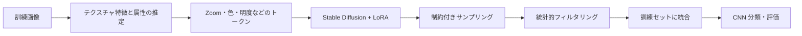

# Land-Cover Augmentation — LoRA-align

**日本語** · [简体中文](README.zh-CN.md) · [English](README.en.md)

航空写真による土地利用分類に向けた、生成的データ拡張の研究コードです。竹林・針葉樹林・水田・茶畑の分類を対象に、実データと観測条件が整合する画像を生成し、少数クラスの学習を補う方法を検討しています。

**Python / PyTorch / CNN / GAN / Diffusion / LoRA / scikit-learn**

## 研究課題

少数クラスの画像を増やすだけでなく、生成画像のスケールや外観を実データに合わせることが分類性能にどう影響するかを調べます。特に、異なる観測スケールが混在する竹林画像に焦点を当てています。

## 手法と実装



- **条件の明示化**：テクスチャ特徴から観測スケールを推定し、色・明度・影・鮮明さなどを離散トークンにします。
- **領域適応**：外部の Stable Diffusion / LoRA 学習実装を利用し、竹林画像向けに微調整します。
- **分布に沿った生成**：属性の条件付き分布、トークンドロップアウト、生成条件の組合せを使います。
- **生成後の選別**：実画像から求めた統計量の分位点範囲で画像を絞り込みます。
- **分類評価**：SmallCNN 系モデル、追加画像、サンプリング、分類損失、Macro-F1・AP・ROC-AUC を扱うコードを収録しています。

LoRA の学習ラッパーは [kohya-ss/sd-scripts](https://github.com/kohya-ss/sd-scripts) を呼び出します。基盤モデルや LoRA 学習アルゴリズムそのものの独自開発を主張するものではありません。

## 卒業論文で報告した結果


| 方法 | Macro-F1 | Macro-AP | ROC-AUC |
| --- | ---: | ---: | ---: |
| Real-only | 0.9244 | 0.9772 | 0.9961 |
| Oversampling | 0.9347 | 0.9807 | 0.9967 |
| Traditional DA | 0.9343 | 0.9803 | 0.9966 |
| LSGAN | 0.9397 | 0.9843 | 0.9976 |
| LoRA | 0.9363 | 0.9829 | 0.9971 |
| **LoRA-align** | **0.9486** | **0.9870** | **0.9977** |

出典は本人の卒業論文「分類性能の比較」の表です。Real-only 以外は竹林画像を 224 枚追加する設定です。**この表は過去の報告値であり、今回の公開準備で再学習した結果ではありません。** 分割、出典、報告値のばらつき、再現上の制約は [実験記録](docs/RESULTS.md) を参照してください。

## ディレクトリ

| パス | 内容 |
| --- | --- |
| [`classifier/`](classifier/) | 後期の SmallCNN 系分類器、データローダーと学習コード |
| [`lora/`](lora/) | 属性タグ、LoRA 学習ラッパー、制約付き生成、特徴可視化 |
| [`CNN_model/`](CNN_model/) | 初期の CNN・GAN・DDPM・画像拡張実験 |
| [`evaluate.py`](evaluate.py) | 保存された予測から指標と図を生成 |
| [`docs/`](docs/) | 実行方法、実験結果、出典と検証範囲 |

初期実験と後期の手法では設定が異なります。初期のデフォルト値を卒業論文の再現条件として扱わないでください。

## 実行

Python 3.10–3.12 を想定しています。画像、モデル重み、外部学習フレームワークは含めていません。

```bash
git clone https://github.com/zephyr-tmc/land-cover-augmentation.git
cd land-cover-augmentation
python3.12 -m venv .venv
source .venv/bin/activate
python -m pip install -r requirements.txt
python classifier/train.py --help
```

データの配置、学習、生成と評価の具体例は [RUNNING.md](docs/RUNNING.md) にあります。

## 検証と制約

実行済みのチェックは [VALIDATION.md](docs/VALIDATION.md) を参照してください。公開準備時の合成データによる動作確認と、元の研究実験の精度評価を区別しています。

データセットと重みは各提供元から別途取得してください。元の研究環境、分割ファイル、全実験ログはこの公開用抜粋に含まれていないため、表の数値をそのまま再現できるとは主張していません。

## 出典・ライセンス

データの出典は [国土地理院 GSI データセット](https://gisstar.gsi.go.jp/gsi-dataset/index_ja.html) です。データ自体は再配布していません。依存ライブラリと基盤モデルにはそれぞれのライセンスが適用されます。独自コードのライセンスは未設定です。
